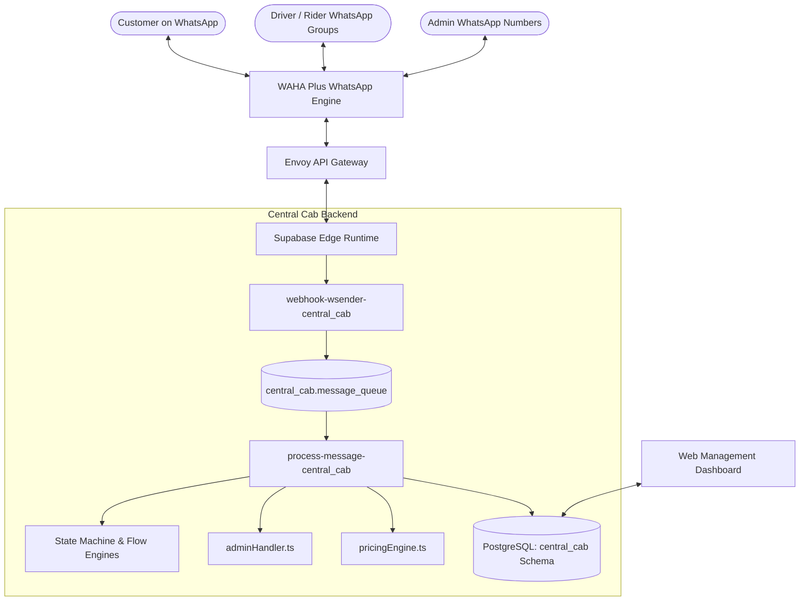
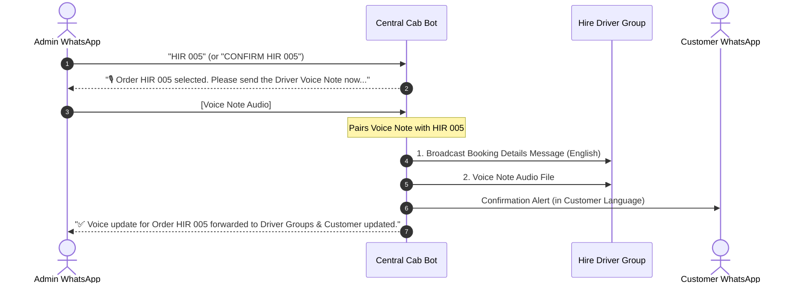

# Ceylon Central Cabs & Delivery — Operations & User Manual
**A Comprehensive Operational Guide for Business Owners, Super Admins, and Operational Staff**

---

## 1. System Overview & Architecture

### 1.1 Introduction
**Ceylon Central Cabs & Delivery** is an automated dispatch and conversational management platform built on top of **WhatsApp**. The system handles customer inquiries, real-time ride bookings, vehicle rentals, package deliveries, scheduled trips, and multilingual customer support automatically, while providing administrative staff with live WhatsApp dispatch controls and a web-based management dashboard.

### 1.2 Technology Architecture


### 1.3 Key System Characteristics
* **Dedicated Database Schema (`central_cab`)**: All orders, bot sessions, FAQs, staff credentials, pricing rates, and message queues are strictly isolated inside the `central_cab` schema in PostgreSQL.
* **Multilingual Engine**: Native support for **English**, **Sinhala (සිංහල)**, and **Tamil (தமிழ்)** with automated detection, memory persistence, and language-specific conversational menus.
* **Dual Confirmation Model**: Combines instant conversational automation with human-in-the-loop admin validation (e.g., driver voice-note forwarding, shop pickup location pinning).

---

## 2. Customer Booking Flows & State Machine

The conversational bot guides customers through distinct state-driven flows based on their choice.

### 2.1 Transport / Cab Flow (`HIR` Series)
Used for instant and scheduled taxi/cab services across all supported vehicle categories (Motorbike, Three-Wheeler, Car, Van, Lorry, Bus).

```
[Main Menu] 
    └── Customer selects "1" (Book a Ride / Cab)
            ├── Step 1: Booking Timing ("Now" vs "Later Schedule")
            │      └── If "Later": Customer inputs Date & Time (e.g. "Tomorrow 8:30 AM")
            ├── Step 2: Vehicle Selection (Motorbike, Tuk-Tuk, Car, Van, etc.)
            ├── Step 3: Pickup Location (WhatsApp Location Pin or Text Address)
            ├── Step 4: Drop-off Location (WhatsApp Location Pin or Text Address)
            ├── Step 5: Customer Name & Phone Confirmation
            └── Step 6: Instant Fare Calculation & Order Creation
```

#### Key Capabilities:
* **Natural Date-Time Parsing**: If the customer chooses a scheduled booking, `dateExtractor.ts` automatically recognizes terms like `"Tomorrow 9:00 AM"`, `"Today 4pm"`, or `"2026-11-05 14:00"`.
* **Precise GPS Location Links**: When a customer shares a WhatsApp location pin, coordinates are saved and converted into clickable Google Maps links (`https://maps.google.com/?q=lat,lng`) for drivers.
* **Automatic Fare Estimation**: The system calculates the shortest road-network distance via the Haversine formula with a calibrated 1.35x curvature index, calculates the price based on active vehicle pricing charts, and presents the quote before order confirmation.
* **Order Code**: Generates a unique tracking code (e.g., `HIR 001`, `HIR 002`).

---

### 2.2 Rent a Car / Hire Vehicle Flow (`RNT` Series)
Designed for vehicle rental inquiries, self-drive rentals, long-term hires, wedding hires, and commercial vehicle leasing.

```
[Main Menu] 
    └── Customer selects "2" (Rent a Car / Vehicle)
            ├── Step 1: Vehicle Requirements & Description
            │      (e.g., "Wagon R, Automatic, AC, Self-Drive" or "KDH Van with Driver")
            ├── Step 2: Rental Duration & Start Date
            │      (e.g., "3 Days, starting tomorrow morning")
            ├── Step 3: Pickup / Delivery Location (Pin or Text)
            ├── Step 4: Customer Contact Info
            └── Step 5: Broadcast to Rent-a-Car Driver Groups
```

#### Key Capabilities:
* **Custom Vehicle Description**: Allows customers to specify exact vehicle preferences, fuel types, transmission (Auto/Manual), and whether a driver is required.
* **Direct Driver Broadcast**: Details are immediately formatted and sent to the **Rent a Car WhatsApp Groups** so fleet owners and vehicle providers can respond.
* **Order Code**: Generates a unique code (e.g., `RNT 001`, `RNT 002`).

---

### 2.3 Delivery Service Flow (`DEL` Series)
Designed for food delivery, grocery purchases, medicine dispatch, parcel pickup, and on-demand courier services.

```
[Main Menu] 
    └── Customer selects "3" (Delivery Service)
            ├── Step 1: Delivery Category & Package Items
            │      (e.g., "Food delivery from Jaffna Road Restaurant: 2x Kottu")
            ├── Step 2: Customer Delivery Drop-off Location (Pin or Text)
            ├── Step 3: Booking Timing ("Now" vs "Later")
            ├── Step 4: Customer Contact Info
            └── Step 5: Order Created & Shop Group Alerted
```

#### Important Operational Rule for Delivery:
> **Why Admin Handles Shop Location**: Customers usually know what they want and where to deliver it to their home, but they do not always know the exact branch, vendor, or shop address. Therefore, the **Admin manually confirms the Shop Pickup Location** using WhatsApp text or a WhatsApp Location Pin before assigning the delivery rider.

---

### 2.4 Multilingual FAQ & Information Flow (`FAQ`)
Customers can inquire about rates, company policies, driver registration, and payment modes:
* Categories include:
  1. `cab_services`: Transport pricing, vehicle availability, outstation rates.
  2. `rent_a_car`: Documents required (ID, driving license, billing), security deposit, self-drive policies.
  3. `delivery`: Parcel weight limits, delivery timelines, prohibited items.
  4. `ask_a_question`: General business inquiries and bank details.
* Responses are fetched dynamically from `central_cab.faqs` matching the customer's current session language.

---

### 2.5 Order Cancellation Flow
Customers can cancel an active booking at any time:
1. Trigger words: `cancel`, `stop`, `ரத்து`, `අවලංගු`.
2. System retrieves the customer's active pending order.
3. System prompts for confirmation: *"Are you sure you want to cancel Order HIR 001? Reply YES to confirm."*
4. Upon confirmation:
   - Order status in database is updated to `cancelled`.
   - Customer receives a formal cancellation notice.
   - Admin receives a cancellation notification.
   - Associated driver groups receive an alert stating the order has been cancelled.

---

## 3. Admin Handling & WhatsApp Dispatch Operations

Administrative operations can be carried out entirely through WhatsApp without logging into the dashboard.

```
┌────────────────────────────────────────────────────────┐
│                   ADMIN DISPATCH MATRIX                │
├───────────────┬────────────────────────────────────────┤
│ Service Type  │ Confirmation Method                    │
├───────────────┼────────────────────────────────────────┤
│ Hire / Cab    │ Order ID + Driver Voice Note Required  │
│ Rent a Car    │ Order ID directly confirms             │
│ Delivery      │ Order ID + Shop Location Pin / Text    │
└───────────────┴────────────────────────────────────────┘
```

---

### 3.1 Hire / Cab Order Confirmation (Voice Note Pipeline)

To ensure high reliability and clear communication with drivers, **Cab/Hire bookings (`HIR`) require a Driver Voice Note before dispatching confirmation to driver groups**.



#### Step-by-Step Execution:
1. **Order Selection**: Admin types `HIR 005` or `CONFIRM HIR 005`.
2. **Bot Prompt**: The bot responds:
   > 🎙️ *Order HIR 005 selected.*  
   > *Please send the Driver Voice Note now. Once received, the confirmed booking details and voice note will be dispatched together to the driver group.*
3. **Voice Note Dispatch**: The admin records or forwards a WhatsApp voice note.
4. **Group Broadcast**: The bot dispatches:
   - Formatted text message with customer pickup, drop-off Google Maps links, fare, and vehicle.
   - The voice note audio file directly into the **Hire Driver Groups**.
   - Confirmation text message to the customer.

---

### 3.2 Rent a Car Confirmation

Rent-a-Car confirmations do not require a voice note.

1. **Confirmation Action**: Admin types `RNT 002` or `CONFIRM RNT 002`.
2. **Immediate Actions**:
   - Order status is set to `confirmed` in the database.
   - A **Booked / No Longer Available** notice is broadcast to the **Rent a Car Groups** in English:
     > ✅ *RENT A CAR BOOKED / CONFIRMED: RNT 002*  
     > *Vehicle: Wagon R*  
     > *Duration: 3 Days*  
     > *Location: Jaffna City*  
     > *📌 This vehicle has been booked and confirmed. No longer available.*
   - Customer receives confirmation that a rental provider has been assigned and will contact them with vehicle photos and contract details.

---

### 3.3 Delivery Order Confirmation & Shop Location Assignment

For delivery orders, the admin assigns the vendor/shop pickup location where the rider needs to purchase or collect the package.

#### Two Ways for Admin to Confirm Delivery:

##### Method A: Single Text Command with Location
Admin replies to the delivery order with the shop address:
```text
CONFIRM DEL 001 Cargills Food City, Jaffna Town
```
*or*
```text
DEL 001 Jaffna Pharmacy, Hospital Road
```

##### Method B: Location Pin Dispatch
1. Admin shares a **WhatsApp Location Pin** of the shop directly in the chat with the bot.
2. The bot stores the location coordinates.
3. Admin then replies with `DEL 001` (or if `DEL 001` was the latest delivery order, sending the location pin immediately attaches to that order).

#### Result of Confirmation:
* **To Delivery Rider Groups**: Dispatches a comprehensive job card with:
  1. 🏪 **Shop Pickup Location**: Formatted with a live Google Maps link.
  2. 📍 **Customer Drop-off Location**: Formatted with a live Google Maps link.
  3. 📦 **Products to Pick Up**: Detailed item list.
  4. 📞 **Customer Contact**: Direct phone number.
* **To Delivery Shop Groups**: Notice that the order is confirmed and a rider is en route for pickup.
* **To Customer**: Notification in their preferred language indicating the order is confirmed and the rider is heading to the shop.

---

### 3.4 Admin WhatsApp Command Quick Reference

| Command Pattern | Example | Effect |
| :--- | :--- | :--- |
| `HIR <num>` | `HIR 001` | Selects hire order; prompts for Driver Voice Note. |
| `CONFIRM HIR <num>` | `CONFIRM HIR 001` | Same as above. |
| `[Voice Note]` | *(Voice Note)* | Attaches audio to previously selected order and dispatches to groups. |
| `RNT <num>` | `RNT 002` | Confirms Rent-a-car; marks as booked in Rent groups. |
| `CONFIRM DEL <num> <Shop>` | `CONFIRM DEL 003 Jaffna Mall` | Confirms delivery with shop text address. |
| `[Location Pin]` | *(WhatsApp Pin)* | Sets shop pickup coordinates for delivery dispatch. |
| `CANCEL <num>` | `CANCEL HIR 001` | Immediately cancels the order and notifies groups. |

---

## 4. WhatsApp Groups Configuration & Bot Setup

To broadcast jobs to drivers, rental agencies, and riders, WhatsApp groups must be configured correctly in both the dashboard and within WhatsApp.

```
┌────────────────────────────────────────────────────────┐
│             FOUR DEDICATED GROUP CHANNELS              │
├─────────────────────────┬──────────────────────────────┤
│ 1. Hire Driver Groups   │ Cab, Tuk-Tuk, Van rides      │
│ 2. Rent a Car Groups    │ Vehicle rental agencies      │
│ 3. Delivery Shop Groups │ Vendors, shops, merchants    │
│ 4. Delivery Rider Groups│ Motorcycle / Delivery riders │
└─────────────────────────┴──────────────────────────────┘
```

---

### 4.1 Step-by-Step Dashboard Setup
1. Log in to the Web Dashboard.
2. Navigate to **Settings** -> **System Settings** -> **Multi-Service Driver Groups**.
3. The dashboard connects to the active WAHA WhatsApp session and lists all WhatsApp groups where the connected bot phone number is currently present.
4. Add the appropriate groups to their corresponding category:
   - **Hire Driver Groups** (`hire_driver_groups`)
   - **Rent a Car Groups** (`rent_a_car_groups`)
   - **Delivery Shop Groups** (`delivery_driver_groups`)
   - **Delivery Rider Groups** (`delivery_rider_groups`)
5. Click **Save System Settings**.

---

### 4.2 CRITICAL Requirements for the Connected Bot Phone Number

To ensure uninterrupted broadcasting, the connected bot phone number **MUST** satisfy two strict WhatsApp conditions:

#### 1. Group Membership
* The WhatsApp phone number connected to the Central Cab bot **must be added as a participant** in every driver and shop group.
* If the number is not a member of the group, WhatsApp API cannot deliver messages to that group JID (`<group_id>@g.us`).

#### 2. Group Messaging Permissions (Admin Rights)
* Many WhatsApp driver groups are configured with restricted permissions:  
  **"Group Settings" -> "Edit Group Settings" -> "Send Messages: Only Admins"**.
* **CRITICAL**: If a driver group is set to *Admins Only*, the connected bot phone number **MUST BE PROMOTED TO GROUP ADMIN**.
* If the bot number is a regular member in an *Admins Only* group, WhatsApp will reject the broadcast, resulting in failed dispatches.

---

### 4.3 Anti-Ban Rate Limiting & Broadcaster Delay
Broadcasting messages to multiple WhatsApp groups simultaneously can trigger automated WhatsApp spam detection if messages are sent too quickly.

* **Configuration**: In **System Settings**, set the **Broadcast Delay Between Groups (Seconds)** (Recommended: **3 to 5 seconds**).
* **Anti-Ban Architecture**:
  - The system enforces this delay between each group broadcast.
  - A randomized jitter (0 to 1,000 milliseconds) is added to each interval to simulate human messaging patterns.
  - This prevents bulk messaging bans on the connected SIM card.

---

## 5. Vehicle Pricing Engine & Fare Calculation

Vehicle rates are managed under **Settings** -> **Vehicle Pricing Settings**.

### 5.1 Supported Vehicle Categories
1. **Motorbike** (Express single-passenger & courier)
2. **Three-Wheeler** (Standard Tuk-Tuk)
3. **Car** (Sedan, Hatchback, Air-conditioned cabs)
4. **Van** (KDH, Mini Van, Caravan)
5. **Lorry** (Light / Heavy transport)
6. **Bus** (Mini Bus / Commercial transport)

---

### 5.2 Pricing Parameters Explained
For each vehicle type, four distinct values are defined:

| Parameter | Unit | Description |
| :--- | :--- | :--- |
| **Base Price** | LKR | The starting fare charged for any trip within the coverage distance. |
| **Coverage Km** | Kilometers | The initial distance included in the Base Price. |
| **Per Km Rate** | LKR / Km | The rate charged for every kilometer traveled beyond the Coverage Km. |
| **Discount %** | Percentage | Optional promotional discount deducted from the calculated fare. |

---

### 5.3 Mathematical Pricing Formula

$$\text{Distance} = \text{Haversine Distance}(\text{Pickup}, \text{Dropoff}) \times 1.35$$

$$\text{Billable Extra Km} = \max(0, \text{Distance} - \text{Coverage Km})$$

$$\text{Gross Fare} = \text{Base Price} + (\text{Billable Extra Km} \times \text{Per Km Rate})$$

$$\text{Final Fare} = \text{Gross Fare} \times \left(1 - \frac{\text{Discount Percentage}}{100}\right)$$

#### Worked Examples:

##### Example 1: Three-Wheeler Short Trip (Within Coverage)
* *Base Price*: 300 LKR
* *Coverage Km*: 2.0 Km
* *Per Km Rate*: 100 LKR
* *Discount*: 10%
* *Trip Distance*: **1.5 Km**
* *Calculation*:
  - Extra Km = $\max(0, 1.5 - 2.0) = 0\text{ Km}$
  - Gross Fare = $300 + (0 \times 100) = 300\text{ LKR}$
  - Final Fare = $300 - (10\% \text{ of } 300) = \mathbf{270\text{ LKR}}$

##### Example 2: Car Long Trip (Beyond Coverage)
* *Base Price*: 600 LKR
* *Coverage Km*: 3.0 Km
* *Per Km Rate*: 150 LKR
* *Discount*: 15%
* *Trip Distance*: **15.0 Km**
* *Calculation*:
  - Extra Km = $15.0 - 3.0 = 12.0\text{ Km}$
  - Additional Charge = $12.0 \times 150 = 1,800\text{ LKR}$
  - Gross Fare = $600 + 1,800 = 2,400\text{ LKR}$
  - Discount Amount = $2,400 \times 0.15 = 360\text{ LKR}$
  - Final Fare = $2,400 - 360 = \mathbf{2,040\text{ LKR}}$

---

## 6. Scheduled Bookings & Custom Vehicle Descriptions

### 6.1 Scheduled Bookings ("Schedule for Later")
Both Transport (`HIR`) and Delivery (`DEL`) flows support advance bookings:
1. When prompted for trip timing, the customer selects **Schedule for Later**.
2. The customer provides the date and time in conversational format:
   - `"Tomorrow morning at 8:00 AM"`
   - `"2026-11-01 at 14:30"`
   - `"Today evening 6pm"`
3. The extraction engine (`dateExtractor.ts`) parses the string into standardized timestamps.
4. When dispatched to driver groups, the schedule is highlighted with priority badges:  
   `⏱️ Scheduled Time: Tomorrow 8:00 AM`.

### 6.2 Vehicle Description in Rent & Scheduled Hires
For rentals and specific scheduled trips, vehicle requirements can be customized:
* **Passenger Capacity**: e.g., *"7-seater van required"*, *"54-passenger bus"*.
* **Climate Control**: AC or Non-AC.
* **Rental Format**: Self-drive (customer drives) or Chauffeur-driven (with driver).
* **Luggage Capacity**: Luggage carrier, boot space requirements for airport transfers.
* These notes are saved in `orders.custom_fields` and broadcast prominently to the driver groups so only equipped operators accept the job.

---

## 7. User Roles: Super Admin vs Sub-Admin / Staff Accounts

The platform implements Role-Based Access Control (RBAC) to ensure security and prevent unauthorized modifications.

```
┌─────────────────────────────────────────────────────────────────┐
│                    USER PERMISSIONS MATRIX                      │
├────────────────────┬─────────────┬──────────────┬───────────────┤
│ Capability / Page  │ Super Admin │ Branch Admin │ General Staff │
├────────────────────┼─────────────┼──────────────┼───────────────┤
│ View Orders        │ ✅ Full     │ ✅ Full      │ ✅ View Only  │
│ Dispatch Orders    │ ✅ Full     │ ✅ Full      │ ❌ Restricted │
│ Manage FAQs        │ ✅ Full     │ ✅ Full      │ ❌ Restricted │
│ Pricing Settings   │ ✅ Full     │ ❌ Restricted│ ❌ Restricted │
│ System Settings    │ ✅ Full     │ ❌ Restricted│ ❌ Restricted │
│ WhatsApp Sessions  │ ✅ Full     │ ❌ Restricted│ ❌ Restricted │
│ Staff Management   │ ✅ Full     │ ❌ Restricted│ ❌ Restricted │
└────────────────────┴─────────────┴──────────────┴───────────────┘
```

---

### 7.1 Super Admin (Master Administrator)
* **Access Level**: Full database and application privileges (`central_cab.app_role = 'super_admin'`).
* **Responsibilities**:
  1. Setting up WhatsApp sessions, pairing QR codes, and monitoring connectivity.
  2. Defining vehicle pricing charts, coverage kilometers, and global discount policies.
  3. Configuring WhatsApp group IDs for Hire, Rent, and Delivery services.
  4. Creating and provisioning staff accounts and setting granular permission flags.
  5. Receiving master dispatch alerts on WhatsApp (`admin_whatsapp_number`).

---

### 7.2 Sub-Admin / Staff Accounts
Staff accounts are managed under the **Admin Accounts / Staff Management** page.
* When inviting a staff member, Super Admins can assign specific permissions:
  * `orders`: Allows viewing and updating customer orders.
  * `faqs`: Allows creating, editing, and categorizing multilingual FAQ entries.
  * `pricing`: Grants access to adjust per-km vehicle pricing.
  * `settings`: Grants access to business settings and driver group assignment.
  * `whatsapp`: Grants access to view WhatsApp QR code pairing status.

#### Service-Specific WhatsApp Admin Numbers:
In **System Settings**, dedicated phone numbers can be assigned for different services:
* `hire_admin_number`: Receives taxi and cab dispatch alerts.
* `rent_admin_number`: Receives vehicle rental and hiring alerts.
* `delivery_admin_number`: Receives delivery requests and handles shop location pins.
* If a dedicated number is not defined, all alerts default to the `admin_whatsapp_number`.

---

## 8. Operational Troubleshooting & Best Practices

### 8.1 WhatsApp Disconnection / QR Expiry
* **Symptom**: Customer messages receive no response, and orders are not being dispatched to groups.
* **Resolution**:
  1. Open the Web Dashboard and navigate to **Settings** -> **WhatsApp Settings**.
  2. Check the session status indicator (should display **Connected**).
  3. If status is **Disconnected** or **Scan QR Code**, click **Restart Session** or scan the displayed QR code using the business WhatsApp account.
  4. Ensure your phone hosting WhatsApp has an active, stable internet connection.

### 8.2 Driver Group Does Not Receive Broadcasts
* **Symptom**: Order is created and confirmed, but the WhatsApp group does not receive the message.
* **Checklist**:
  1. **Is the Bot a Group Member?** Check WhatsApp to confirm the connected bot number is inside that group.
  2. **Is the Group "Admins Only"?** If group settings allow only admins to send messages, verify that the bot number has been **promoted to Group Admin**.
  3. **Is the Group Added in Settings?** Go to **Settings** -> **System Settings** -> **Multi-Service Driver Groups** and verify that the group appears in the designated list.

### 8.3 Delivery Order Not Reaching Delivery Riders
* **Symptom**: Delivery order was created, but riders are not receiving the job.
* **Resolution**:
  - Delivery orders **are not dispatched to rider groups automatically on customer submission**.
  - An Admin must reply with `CONFIRM DEL <order_code> <Shop Location>` or send a WhatsApp Location Pin of the shop. Once the admin specifies the shop pickup location, the job is immediately dispatched to the **Delivery Rider Groups**.

---
*Document Version: 2.4*  
*Target Environment: Ceylon Central Cabs & Delivery Production Suite*  
*Last Updated: October 2026*
